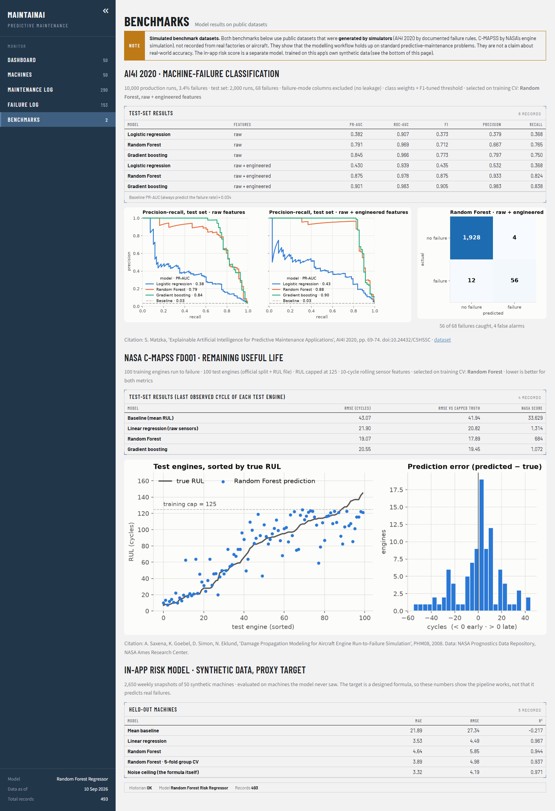

# MaintainAI — predictive maintenance dashboard

A small maintenance-management app for a factory floor. It keeps a register of machines and logs their maintenance and failures. A machine-learning model gives every machine a **risk score from 0 to 100**, explains each score in plain words, and ranks the fleet so the riskiest machines get inspected first.

Built with **Python · pandas · scikit-learn · SHAP · Streamlit · SQLite**. The modelling is also tested on two public predictive-maintenance benchmarks (AI4I 2020 and NASA C-MAPSS).

**Live demo:** _coming soon — link will go here_ <!-- replace with the share.streamlit.io URL after deploying -->


> **Honesty note.** The app's database is **synthetic**, and its risk model is trained on a **designed formula** rather than on real failure outcomes, because no real failure data was available. Its accuracy shows that the pipeline works; it is **not** a claim that it predicts real breakdowns. The two benchmarks use public datasets that are also **simulated**. Details below.

---

## Features

| Page | What it does |
|---|---|
| **Dashboard** | Fleet counts by status (Normal / Warning / Critical), an alarm banner for critical machines, risk score per machine, failures per month, and a sortable health table with the **main risk drivers** for each machine |
| **Explain a score** | Pick any machine to see how each factor pushed its score up or down (SHAP values) |
| **Machines** | Asset register and an add-machine form |
| **Maintenance Log** | Filterable service history and a log-maintenance form |
| **Failure Log** | Filterable breakdown history with downtime and repair time, and a log-failure form |
| **Benchmarks** | Results of the AI4I 2020 and C-MAPSS notebooks, plus the in-app model's own evaluation |

Records you add are saved to the SQLite database, and the affected machine's risk score updates straight away.

## How the risk score works

1. **Features.** For each machine, eight inputs are computed from the logs ([`risk_features.py`](risk_features.py)): age, operating hours, days since last maintenance, failures and downtime in the last 12 months, maintenance events per year, and the average temperature and vibration over the last 8 weeks. "Now" is the date of the latest record, so the frozen demo data doesn't drift towards Critical as real time passes.
2. **Target (the honest part).** There are no real failure labels. Instead, the target is a documented **proxy formula**: each feature is scaled between a fixed *healthy* and *bad* value, combined with weights that sum to 1 (failures 0.22, days since maintenance 0.16, vibration 0.16, temperature 0.12, downtime 0.10, age 0.10, hours 0.08, maintenance frequency 0.06), and Gaussian noise (σ = 4 points) is added.
3. **Training data.** The 50 machines are only 50 rows, so every machine's features are rebuilt **as of every week** of the last year: 2,650 snapshots.
4. **Model.** A `RandomForestRegressor` (300 trees). The score is bucketed as Normal (< 40), Warning (40–69) or Critical (≥ 70).
5. **Evaluation without leakage.** Snapshots of the same machine in neighbouring weeks are near-duplicates, so the test set holds out **whole machines** the model never saw.

| Held-out machines | MAE | RMSE | R² |
|---|---|---|---|
| Random Forest (5-fold group CV, mean ± sd) | 3.89 ± 0.37 | 4.98 | 0.937 |
| Random Forest (one split, 10 machines) | 4.64 | 5.85 | 0.944 |
| Linear regression | 3.53 | 4.49 | 0.967 |
| Always predict the mean | 21.89 | 27.34 | −0.22 |
| Noise ceiling (the formula itself) | 3.32 | 4.19 | 0.971 |

How to read this:
- The forest is within ~0.6 points of the best possible error.
- Linear regression wins here because the target is a weighted sum *by construction*. The forest is kept because real failure processes aren't linear, and because it gives exact SHAP explanations.
- An earlier version of this model reported MAE 3.37 / R² 0.959 using a random row split. That split leaks near-duplicate rows between train and test, and gives about the same numbers here (3.47 / 0.959). The machine-level numbers above are the honest ones.

Full walkthrough: [`notebooks/01_risk_model_synthetic.ipynb`](notebooks/01_risk_model_synthetic.ipynb).

## Explanations

Every score is broken down with `shap.TreeExplainer`: the fleet's average score plus each feature's contribution equals the machine's score exactly. The health table shows the two biggest risk-raising factors in plain words, e.g. *"high vibration (10.8 mm/s) · high temperature (78 °C)"*. Below the table, you can pick any machine to see its full breakdown.


One caveat, found while building this: in the synthetic data the features are strongly correlated (operating hours vs. age r = 0.99, vibration vs. hours 0.93), because every machine was generated from a healthy, average or high-risk profile. The model therefore leans on vibration and hours as a stand-in for the whole profile, and gives failure count little weight even though the formula weights it most. **SHAP explains the model, not the formula.** Notebook 01 shows this in detail.

## Benchmarks on public datasets

Both datasets are **simulated** public benchmarks: AI4I 2020 was generated from documented failure rules, and C-MAPSS with NASA's engine simulator. They test the modelling workflow on standard problems, not real-world accuracy. The notebooks download the data themselves; only small result files are kept in [`results/benchmarks/`](results/benchmarks).

### AI4I 2020 — will this production run end in a machine failure?

10,000 runs, 3.4 % failures. The failure-mode columns (TWF, HDF, PWF, OSF, RNF), `UDI` and `Product ID` are excluded to avoid leakage. Imbalance is handled with class weights plus a decision threshold tuned for F1 on cross-validated training predictions. Test set: 2,000 runs, 68 failures. The engineered features are temperature difference, mechanical power and tool wear × torque.

| Model | Features | PR-AUC | ROC-AUC | F1 | Precision | Recall |
|---|---|---|---|---|---|---|
| Baseline (failure rate) | – | 0.034 | 0.500 | – | – | – |
| Logistic regression | raw | 0.382 | 0.907 | 0.373 | 0.379 | 0.368 |
| Random Forest | raw | 0.791 | 0.969 | 0.712 | 0.667 | 0.765 |
| Gradient boosting | raw | 0.845 | 0.966 | 0.773 | 0.797 | 0.750 |
| Logistic regression | raw + engineered | 0.430 | 0.939 | 0.435 | 0.532 | 0.368 |
| **Random Forest** (selected on training CV) | raw + engineered | **0.875** | 0.978 | **0.875** | 0.933 | 0.824 |
| Gradient boosting | raw + engineered | 0.901 | 0.983 | 0.905 | 0.983 | 0.838 |

The selected model catches 56 of 68 failures with 4 false alarms. Notebook: [`02_benchmark_ai4i2020.ipynb`](notebooks/02_benchmark_ai4i2020.ipynb).

### NASA C-MAPSS FD001 — how many cycles until this engine fails?

100 training engines run to failure, 100 test engines cut off early. The official split and `RUL_FD001.txt` are used. Remaining useful life (RUL) is capped at 125 for training. Features are 10-cycle rolling sensor statistics. Lower is better for both metrics; the NASA score punishes late predictions more than early ones.

| Model | RMSE (cycles) | RMSE vs. capped truth | NASA score |
|---|---|---|---|
| Baseline (mean RUL) | 43.07 | 41.94 | 33,629 |
| Linear regression (raw sensors) | 21.90 | 20.82 | 1,314 |
| **Random Forest** (selected on training CV) | **19.07** | **17.89** | **685** |
| Gradient boosting | 20.55 | 19.45 | 1,072 |

For context, published FD001 results are roughly RMSE 16–18 for classic ML and 11–13 for deep sequence models. Notebook: [`03_benchmark_nasa_cmapss.ipynb`](notebooks/03_benchmark_nasa_cmapss.ipynb).



## Screenshots

| | |
|---|---|
|  |  |
| Health table with plain-words risk drivers | Asset register and add-machine form |
|  |  |
| Failure log with filters and form | Per-machine score breakdown |

## Run it locally

Requires Python 3.12.

```bash
python -m venv .venv
.venv\Scripts\activate          # Windows; on macOS/Linux: source .venv/bin/activate
pip install -r requirements.txt
streamlit run app.py
```

Then open http://localhost:8501. Notes:
- On the very first run Streamlit may ask for an email in the terminal; just press Enter.
- Use Chrome or Edge. In Brave, text fields may not repaint while you type (the data still saves).

**Retrain the model** (rewrites `risk_model.pkl` and `results/risk_model/`):

```bash
python training/train_risk_model.py
```

**Notebooks, tests and screenshots** need the dev requirements:

```bash
pip install -r requirements-dev.txt
```

Open the notebooks in VS Code or Jupyter (`pip install jupyterlab`). Notebooks 02 and 03 download their datasets into `data/`, which git ignores.

## Tests

```bash
python -m pytest
```

18 tests:
- Streamlit's `AppTest` loads every page and submits every form. Each test writes to a temporary copy of the database, and a session-level check fails the run if the real `factory_maintenance.db` changes.
- The model bundle loads without version warnings and predicts within 0–100.
- Features never use records from the future.
- SHAP contributions add up to the prediction.

Screenshots in `docs/screenshots/` are produced with Playwright (also against a temporary database copy):

```bash
python -m playwright install chromium
python scripts/take_screenshots.py
```

## Deploying (Streamlit Community Cloud)

The app runs as-is on [share.streamlit.io](https://share.streamlit.io):
- entry point: `app.py`
- dependencies: `requirements.txt`
- paths are relative to the repo
- no secrets are needed
- Python 3.12 is recommended

Records added in the hosted demo are temporary: the container's disk resets when the app restarts.

## Project structure

```
app.py                     Streamlit app: sidebar navigation, pages, forms
ui.py                      HTML renderers for the read-only surfaces (cards, charts, tables, explanation panel)
theme_css.py               Styling for Streamlit's own widgets
data.py                    Loads data, scores machines, SHAP explanations, database writes
risk_features.py           Feature engineering + the proxy risk formula (shared by app and training)
db_utils.py                SQLite connection and query helpers (MAINTAINAI_DB overrides the path)
factory_maintenance.db     Synthetic demo database (50 machines, ~2 years of records)
risk_model.pkl             Trained model bundle: {"model", "features", "thresholds"}
training/
  train_risk_model.py      Builds snapshots, evaluates, saves risk_model.pkl
notebooks/
  01_risk_model_synthetic.ipynb
  02_benchmark_ai4i2020.ipynb
  03_benchmark_nasa_cmapss.ipynb
  plot_style.py            Shared figure style
results/                   Metrics (JSON/CSV) and figures written by the notebooks and training script
tests/                     AppTest + model tests
scripts/take_screenshots.py
docs/screenshots/
.streamlit/config.toml     Light theme, viewer toolbar
SPEC.md                    Living spec: decisions, assumptions, open questions, change log
```

## Data and citations

- **App data:** `factory_maintenance.db` is synthetic, generated for this project. It contains no real factory or personal data.
- **AI4I 2020:** S. Matzka, "Explainable Artificial Intelligence for Predictive Maintenance Applications," *2020 Third International Conference on Artificial Intelligence for Industries (AI4I)*, 2020, pp. 69–74. Dataset: [UCI Machine Learning Repository](https://archive.ics.uci.edu/dataset/601/ai4i+2020+predictive+maintenance+dataset), doi:[10.24432/C5HS5C](https://doi.org/10.24432/C5HS5C), CC BY 4.0.
- **C-MAPSS:** A. Saxena, K. Goebel, D. Simon, N. Eklund, "Damage Propagation Modeling for Aircraft Engine Run-to-Failure Simulation," *International Conference on Prognostics and Health Management (PHM08)*, 2008. Data: A. Saxena and K. Goebel, "Turbofan Engine Degradation Simulation Data Set," NASA Prognostics Data Repository, NASA Ames Research Center.

## License

[MIT](LICENSE) © 2026 Yassine Maazaoui
