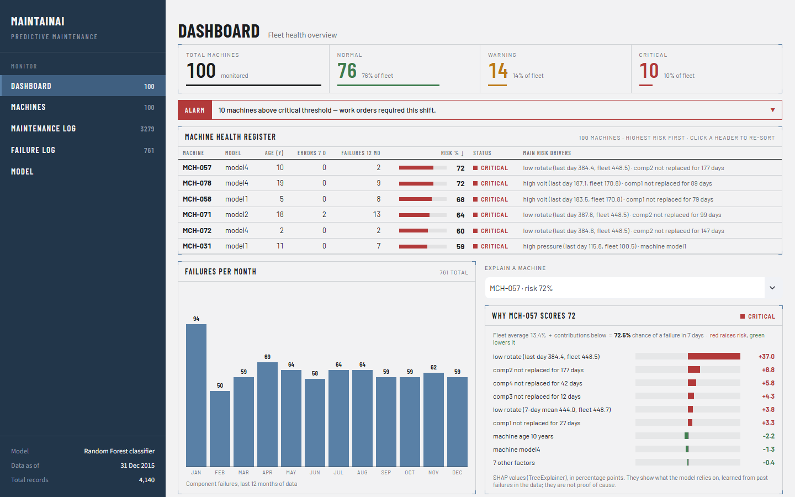
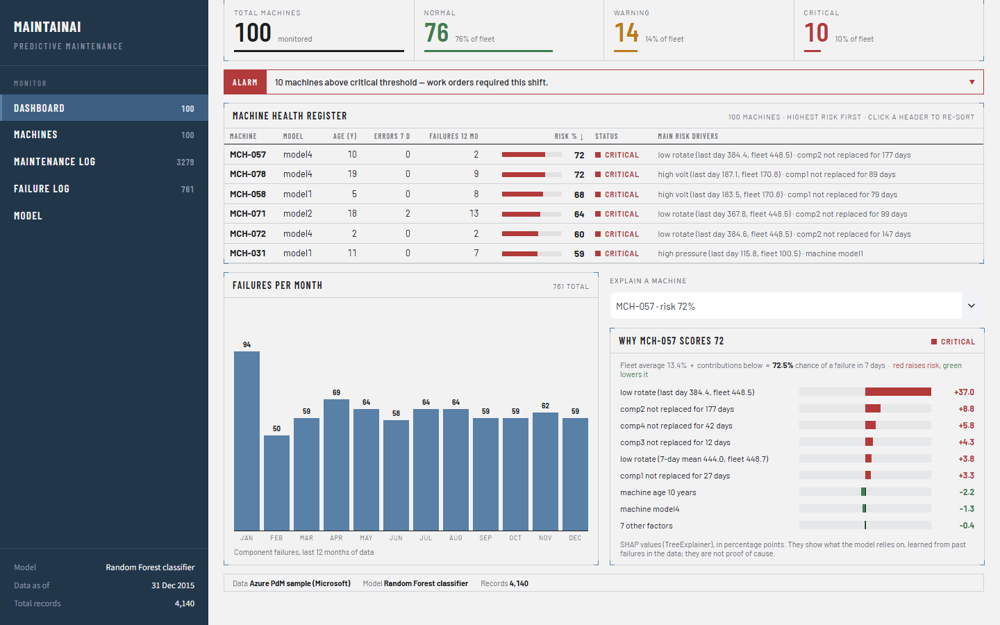
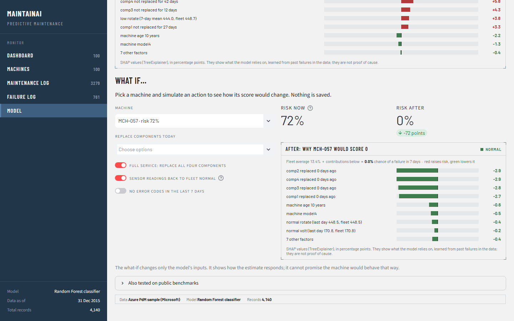
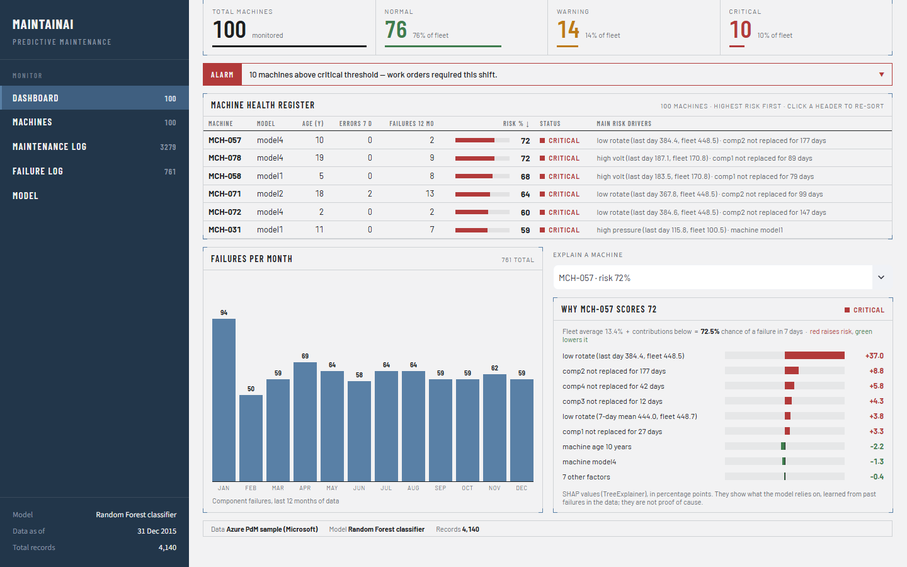
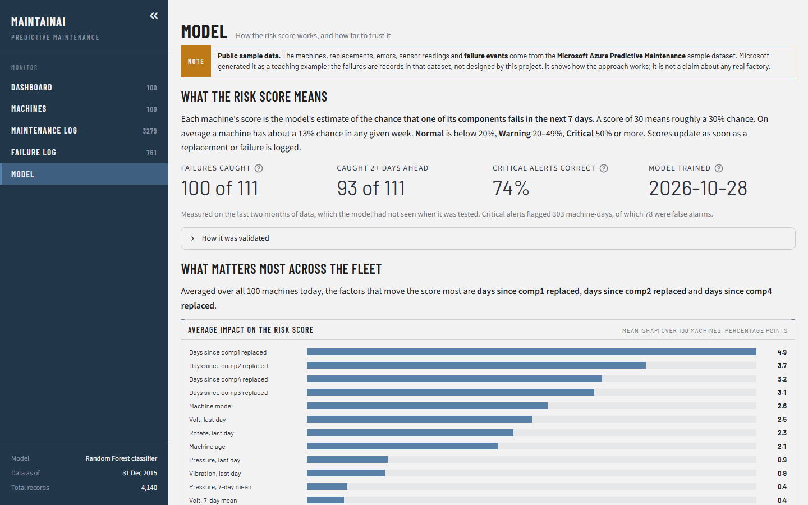
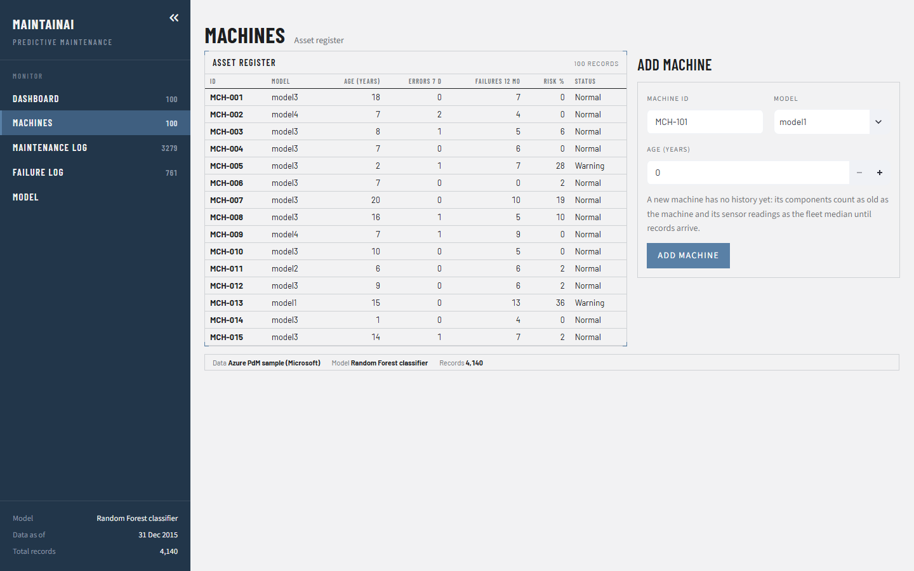
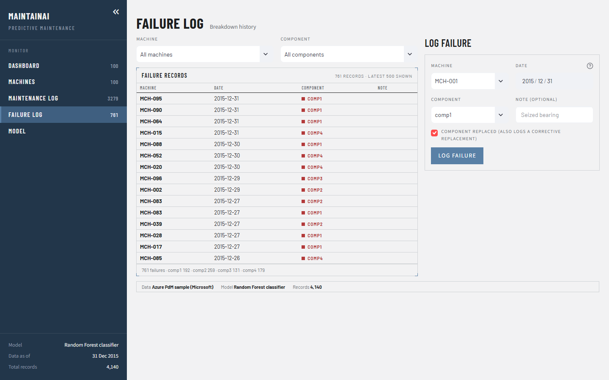

# MaintainAI — predictive maintenance dashboard

A small maintenance-management app for a fleet of 100 machines. It keeps a register of machines and logs their component replacements and failures. A machine-learning model gives every machine a **risk score: the chance (0–100%) that one of its components fails in the next 7 days**, learned from real failure events in a public dataset. Every score is explained in plain words, and a what-if tool shows how an action (replace a part, fix a fault) would change it.

Built with **Python · pandas · scikit-learn · SHAP · Streamlit · SQLite**. The modelling is also tested on two public predictive-maintenance benchmarks (AI4I 2020 and NASA C-MAPSS).

**Live demo:** https://maintainai1.streamlit.app/



> **About the data.** The app runs on the **Microsoft Azure Predictive Maintenance** sample dataset: 100 machines through 2015, with sensor readings, error codes, component replacements and **761 recorded component failures**. Microsoft generated it as a teaching example, so it is not data from a real factory. The failure events are records in that dataset, not something this project designed. See [Data source](#data-source).

---

## Features

| Page | What it does |
|---|---|
| **Dashboard** | Fleet counts by status (Normal / Warning / Critical), an alarm banner for critical machines, the machine health table (highest risk first, with the **main risk drivers** for each machine), failures per month, and a per-machine explanation |
| **Machines** | Asset register (model, age, recent errors and failures, risk) and an add-machine form |
| **Maintenance Log** | Component replacements (scheduled or corrective), filterable, and a form to log a replacement |
| **Failure Log** | Component failures, filterable, and a form to log a failure (optionally logging the replacement too) |
| **Model** | How the score works and how far to trust it: test results, which factors matter across the fleet (SHAP), a per-machine explanation, a **what-if tool**, and the public benchmark results |

**To see why a machine scores what it does, pick it in the "Explain a machine" dropdown** below the health table. The table itself is display-only; you can click its headers to re-sort it.

Records you add are saved to the SQLite database, and the affected machine's risk score updates straight away. The demo data ends on 31 Dec 2015, so the app treats that date as "today", and the forms default to it.

## How the risk score works

1. **One row per machine per day.** For each day, the model sees only what was known by the end of that day ([`risk_features.py`](risk_features.py)):
   - days since each of the four components was last replaced
   - that day's mean voltage, rotation, pressure and vibration, and their 7-day means
   - error codes logged in the last 7 days
   - machine age and model
2. **Label.** Did the machine have a component failure in the next 7 days? This is true for 13.4% of the 35,200 machine-days.
3. **Time-based split.** Train on Jan–Aug 2015, choose the model and thresholds on Sep–Oct, test once on Nov–Dec. The 7 days before each boundary are dropped from the earlier block, because their labels look into the next one. A random split would put neighbouring days of the same machine on both sides.
4. **Model.** Logistic regression, a Random Forest and gradient boosting were compared on validation PR-AUC. The **Random Forest** (100 trees, `min_samples_leaf=10`, `max_features=0.33`) won, and was refit on all labelled days for the app.
5. **Score and status.** The score is the forest's probability × 100. **Critical ≥ 50%**: a failure in the next week is more likely than not. **Warning ≥ 20%**: about 1.5× the average weekly risk. 20% is the highest cut-off that still flagged 80% of the days before a failure on validation. **Normal** is below 20%.
6. **Calibration.** The validation calibration error was 0.022, below the 0.05 limit set in advance, so no calibration step was added. Isotonic calibration would only have moved the test Brier score from 0.0725 to 0.0719, and leaving it out keeps the SHAP explanations exact.

Full walkthrough: [`notebooks/01_risk_model_azure.ipynb`](notebooks/01_risk_model_azure.ipynb). Training: [`training/train_risk_model.py`](training/train_risk_model.py).

## Results (test months: Nov–Dec 2015)

| Model | PR-AUC (validation) | PR-AUC (test) | ROC-AUC (test) | Brier (test) | Precision ≥ 50% | Recall ≥ 50% |
|---|---|---|---|---|---|---|
| Always predict the failure rate | 0.125 | 0.126 | 0.500 | 0.110 | – | – |
| Logistic regression | 0.293 | 0.293 | 0.689 | 0.102 | 0.55 | 0.04 |
| **Random Forest** (selected on validation) | **0.633** | **0.630** | 0.909 | 0.072 | 0.74 | 0.33 |
| Gradient boosting | 0.614 | 0.628 | 0.913 | 0.071 | 0.73 | 0.39 |

Precision and recall here count machine-days. Per **failure event**, on the test months:

| Alert level | Failures with an alert in the 7 days before | …at least 2 days ahead | Median warning | Machine-days flagged | False alarms |
|---|---|---|---|---|---|
| **Critical** (≥ 50%) | **100 of 111** | 93 | 2 days | 303 | 78 (26%) |
| Warning or above (≥ 20%) | 108 of 111 | 105 | 7 days | 1,449 | 890 (61%) |

How to read this:
- Critical alerts are mostly right (3 in 4), and most failures get one, but usually only a couple of days ahead. The model mostly reacts to sensor drift that starts shortly before a failure. It is an early warning, not a long-range forecast.
- The Warning level catches almost every failure a week ahead, at the cost of many false alarms. It is meant as a watch list, not a work-order trigger.
- Gradient boosting scores about the same on test. The forest was chosen on validation, before the test months were looked at.
- This is one year of generated data, in which failures announce themselves through clean sensor signatures. Real plants are messier, so these numbers show the method works, not how it would perform elsewhere.

## Explanations and what-if

Every score is broken down with `shap.TreeExplainer`. The fleet's average risk (13.4%) plus each factor's contribution, in percentage points, equals the machine's score exactly. The health table shows the two biggest risk-raising factors in plain words, e.g. *"low rotate (last day 384.4, fleet 448.5) · comp2 not replaced for 177 days"*.



The **Model** page adds:
- **Global SHAP:** the average impact of each factor across the fleet. Component ages, machine model and the latest sensor readings lead.
- **What-if:** pick a machine, then replace components today, bring its sensor readings back to the fleet median, or clear its recent error codes. The page shows how the score and its explanation would change. Nothing is saved, and the page says plainly that the model's response is not a guarantee.



## Benchmarks

The same workflow was tested on two standard public benchmarks. Both are **simulated** datasets, so they test the modelling, not real-world accuracy. The notebooks download their own data; only small result files are committed. The results also appear on the Model page, under "Also tested on public benchmarks".

| Benchmark | Task | Result (test set) | Notebook | Results |
|---|---|---|---|---|
| **AI4I 2020** | Will this production run end in a machine failure? (10,000 runs, 3.4% failures) | Random Forest, raw + engineered features: PR-AUC **0.875**, F1 0.875. It catches 56 of 68 failures with 4 false alarms | [`02_benchmark_ai4i2020.ipynb`](notebooks/02_benchmark_ai4i2020.ipynb) | [`results/benchmarks/ai4i2020/`](results/benchmarks/ai4i2020) |
| **NASA C-MAPSS FD001** | How many cycles until this engine fails? (100 train / 100 test engines) | Random Forest on 10-cycle rolling features: RMSE **19.07** cycles, NASA score 685 (published classic ML ≈ 16–18) | [`03_benchmark_nasa_cmapss.ipynb`](notebooks/03_benchmark_nasa_cmapss.ipynb) | [`results/benchmarks/cmapss_fd001/`](results/benchmarks/cmapss_fd001) |

Leakage controls: on AI4I, the failure-mode columns, `UDI` and `Product ID` are excluded, and the threshold is tuned on cross-validated training predictions. On C-MAPSS, the official split and `RUL_FD001.txt` are used, with RUL capped at 125 for training. In both cases the model was chosen on training CV and the test set was used once.

## Screenshots

| | |
|---|---|
|  |  |
| Health table: highest risk first, plain-words drivers | Model page: what the score means, test results, global SHAP |
|  |  |
| Asset register and add-machine form | Failure log with filters and form |

## Data source

- **Microsoft Azure Predictive Maintenance sample data**, created by Microsoft. Copy used: [Kaggle — Microsoft Azure Predictive Maintenance](https://www.kaggle.com/datasets/arnabbiswas1/microsoft-azure-predictive-maintenance).
- **License:** not clearly stated by the source.
- **Use here:** educational, **non-commercial demonstration only**. A real deployment would load its own machine data into the same tables.
- **What is committed:** only `maintainai.db` (3.8 MB), built by [`training/build_azure_db.py`](training/build_azure_db.py). It holds the machines, replacements, failures, errors and **daily** sensor means. The raw CSVs (hourly telemetry, ~80 MB) are not committed; `data/` is git-ignored.
- **Removal:** the demo data will be removed on the owner's request.

What the build script changes: `machineID` 1–100 becomes `MCH-001`…`MCH-100`; hourly telemetry becomes daily means; timestamps become dates; the first hours of 2016-01-01 are dropped (not a full day); and a replacement on the same day as a failure of that component is typed "Corrective" (743 of 3,279), the rest "Scheduled".

## Run it locally

Requires Python 3.12.

```bash
python -m venv .venv
.venv\Scripts\activate          # Windows; on macOS/Linux: source .venv/bin/activate
pip install -r requirements.txt
streamlit run app.py
```

Then open http://localhost:8501. Notes:
- On the very first run Streamlit may ask for an email in the terminal; just press Enter.
- Use Chrome or Edge. In Brave, text fields may not repaint while you type (the data still saves).

**Retrain the model** (rewrites `risk_model.pkl` and `results/risk_model/metrics.json`; needs only the committed database):

```bash
python training/train_risk_model.py
```

**Rebuild the database from the raw CSVs** (optional). Download the five `PdM_*.csv` files from the Kaggle page above into `data/azure_pdm/`, then:

```bash
python training/build_azure_db.py
```

**Notebooks, tests and screenshots** need the dev requirements:

```bash
pip install -r requirements-dev.txt
```

Open the notebooks in VS Code or Jupyter (`pip install jupyterlab`). Notebook 01 reads `maintainai.db` and writes the figures in `results/risk_model/`. Notebooks 02 and 03 download their datasets into `data/`.

## Tests

```bash
python -m pytest
```

24 tests:
- Streamlit's `AppTest` loads every page and submits every form, and checks that logging replacements changes a machine's score and that the what-if responds without writing anything. Each test uses a temporary copy of the database, and a session-level check fails the run if the real `maintainai.db` changes.
- Features never use records from the future; labels look exactly 7 days ahead; the train/validation/test blocks keep a 7-day gap.
- The Python features match the database's `Machine_Risk_Features` view.
- SHAP contributions add up to the score; the what-if changes only the inputs it should.
- The model bundle loads without version warnings.

Screenshots in `docs/screenshots/` are produced with Playwright, also against a temporary database copy:

```bash
python -m playwright install chromium
python scripts/take_screenshots.py
```

## Deploying (Streamlit Community Cloud)

The live demo runs on [share.streamlit.io](https://share.streamlit.io) straight from this repository:
- entry point: `app.py`
- dependencies: `requirements.txt` (exact pins)
- Python 3.12
- no secrets needed

At runtime the app needs only `maintainai.db` (3.8 MB) and `risk_model.pkl` (3 MB); the raw CSVs are not used. Records added in the hosted demo are temporary: the container's disk resets when the app restarts.

## Project structure

```
app.py                     Streamlit app: sidebar navigation, pages, forms, what-if
ui.py                      HTML renderers for the read-only surfaces (cards, charts, tables, explanation panels)
theme_css.py               Styling for Streamlit's own widgets
data.py                    Loads data, scores machines, SHAP explanations, what-if, database writes
risk_features.py           Daily features + 7-day failure labels (shared by app and training)
db_utils.py                SQLite connection and query helpers (MAINTAINAI_DB overrides the path)
maintainai.db              Demo database: daily aggregates of the Azure PdM sample data
risk_model.pkl             Trained model bundle: {"model", "features", "thresholds"}
training/
  build_azure_db.py        Raw Azure CSVs -> maintainai.db
  train_risk_model.py      Time-based evaluation, model choice, thresholds, saves risk_model.pkl
notebooks/
  01_risk_model_azure.ipynb
  02_benchmark_ai4i2020.ipynb
  03_benchmark_nasa_cmapss.ipynb
  plot_style.py            Shared figure style
results/                   Metrics (JSON/CSV) and figures written by the notebooks and training script
tests/                     AppTest + model tests
scripts/take_screenshots.py
docs/screenshots/
.streamlit/config.toml     Light theme, viewer toolbar
SPEC.md                    Living spec: decisions, assumptions, open questions, change log
```

## Citations

- **Azure Predictive Maintenance:** Microsoft, Azure Predictive Maintenance sample data. Copy: [Kaggle](https://www.kaggle.com/datasets/arnabbiswas1/microsoft-azure-predictive-maintenance). License not clearly stated; used for a non-commercial educational demo.
- **AI4I 2020:** S. Matzka, "Explainable Artificial Intelligence for Predictive Maintenance Applications," *2020 Third International Conference on Artificial Intelligence for Industries (AI4I)*, 2020, pp. 69–74. Dataset: [UCI Machine Learning Repository](https://archive.ics.uci.edu/dataset/601/ai4i+2020+predictive+maintenance+dataset), doi:[10.24432/C5HS5C](https://doi.org/10.24432/C5HS5C), CC BY 4.0.
- **C-MAPSS:** A. Saxena, K. Goebel, D. Simon, N. Eklund, "Damage Propagation Modeling for Aircraft Engine Run-to-Failure Simulation," *International Conference on Prognostics and Health Management (PHM08)*, 2008. Data: A. Saxena and K. Goebel, "Turbofan Engine Degradation Simulation Data Set," NASA Prognostics Data Repository, NASA Ames Research Center.

## License

Code: [MIT](LICENSE) © 2026 Yassine Maazaoui. The MIT license covers this project's code only, not the Azure sample data in `maintainai.db` (see [Data source](#data-source)).
